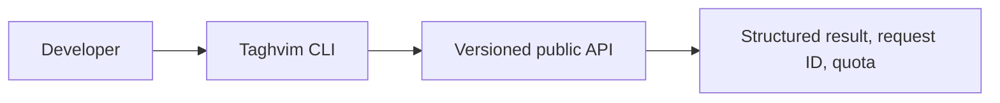

<h1 lang="fa" dir="rtl">Taghvim.dev CLI | ابزار خط فرمان تقویم.dev</h1>

<p dir="rtl" lang="fa">ابزار خط فرمان متن‌باز برای توسعه‌دهندگان تقویم.dev؛ اجرای فرمان‌های تقویم، تعطیلات، روزهای کاری، زمان‌بندی و مشاهدهٔ مصرف API. نسخهٔ کنونی <strong>آزمایشی</strong> است و کد آن تحت مجوز Apache-2.0 عرضه می‌شود.</p>

**Early-access preview:** publishing this CLI does not enable automatic registration, test-key issuance, billing or a production SLA. Run API commands only with a test key issued through an authorized invitation.

## ثبت‌نام دسترسی آزمایشی — مسیر رسمی مشترک

<p dir="rtl" lang="fa">برای دریافت کلید API، از <a href="https://taghvim.dev/#access">فرم رسمی دسترسی زودهنگام تقویم.dev</a> ثبت‌نام کنید. درخواست شما در فهرست واحد Early Access ثبت و ایمیل تأیید ارسال می‌شود. <strong>از ۷ روز پس از ثبت‌نام</strong>، در صورت آماده‌بودن سرویس و نبود انصراف یا مسدودسازی، دعوت‌نامهٔ اختصاصی ارسال می‌شود؛ پیوند آن <strong>۷۲ ساعت</strong> معتبر است. بعد از پذیرش دعوت‌نامه، Tenant مستقل و کلید آزمایشی ساخته می‌شود؛ <strong>دورهٔ آزمایشی کامل ۳۰روزه از لحظهٔ فعال‌سازی آغاز می‌شود</strong>، نه از تاریخ ثبت‌نام یا ارسال دعوت‌نامه. چرخش کلید، پایان این دوره را عقب نمی‌اندازد. نیازی به کارت بانکی نیست و دسترسی Production صادر نمی‌شود.</p>

<p dir="rtl" lang="fa">خبرهای محصول فقط با رضایت جداگانه و اختیاری ارسال می‌شوند. کلید API در ایمیل فرستاده نمی‌شود و فقط هنگام فعال‌سازی یک‌بار نمایش داده می‌شود. <a href="https://taghvim.dev/#privacy">حریم خصوصی</a> · <a href="https://taghvim.dev/#terms">شرایط</a> · <a href="https://api.taghvim.dev/developer">پذیرش دعوت‌نامه</a> · <a href="https://api.taghvim.dev/openapi.json">OpenAPI</a>. صدور دعوت‌نامه تابع آمادگی عملیاتی سرویس است؛ صرفِ ثبت درخواست کلید صادر نمی‌کند.</p>

## Run from source

Node.js 20+ required; no runtime dependencies.

```bash
git clone https://github.com/Taghvim-dev/CLI.git
cd CLI
node bin/taghvim.mjs --help
node bin/taghvim.mjs operations
node bin/taghvim.mjs health
```

For an authorized test key:

```bash
export TAGHVIM_TEST_API_KEY="tgv_test_YOUR_ISSUED_KEY"
node bin/taghvim.mjs convert 1405-07-15
node bin/taghvim.mjs business-days add 1405-07-15 30
node bin/taghvim.mjs holidays 1405 7
node bin/taghvim.mjs schedule-preview 1405-07-01 last-business 4
node bin/taghvim.mjs usage 1405-07
```

PowerShell: `$env:TAGHVIM_TEST_API_KEY = "tgv_test_YOUR_ISSUED_KEY"`. Do not paste keys into command arguments or commit them.

The public operation index is pinned in [contracts/operation-index.json](contracts/operation-index.json). Every command must map to a versioned non-admin operation. Local CI tests are independent of the publication timing of sibling repositories; the organization-level coordinated release process checks API → SDK → CLI → cookbooks parity.

[CLI design and safety](docs/CLI-RELEASE-GATES.md) · [SDK](https://github.com/Taghvim-dev/SDK) · [Cookbooks](https://github.com/Taghvim-dev/cookbooks) · [Product](https://taghvim.dev/).



**License:** Apache-2.0 original code and docs, with trademark rights reserved. The CLI is not yet an npm registry release.
