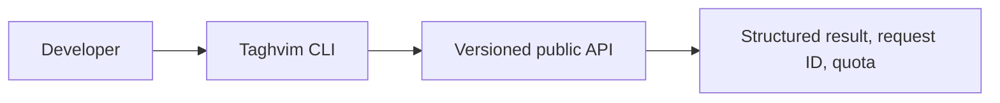

<h1 lang="fa" dir="rtl">Taghvim.dev CLI | ابزار خط فرمان تقویم.dev</h1>

## 🧪 درخواست API Key و آزمایش رایگان ۳۰روزه | 30-day developer trial

**[ثبت‌نام برای دریافت API Key آزمایشی](https://taghvim.dev/#access)** · **[Request an API test key](https://taghvim.dev/#access)**

با ثبت درخواست دسترسی زودهنگام، ایمیل تأیید دریافت می‌کنید. پس از **۷ روز**، در صورت آماده‌بودن سرویس و برقرار بودن شرایط دسترسی، دعوت‌نامهٔ یک‌بارمصرف به همان ایمیل فرستاده می‌شود. پیوند دعوت تا **۷۲ ساعت** اعتبار دارد. پس از فعال‌سازی دعوت‌نامه، Tenant آزمایشی و کلید `tgv_test_...` صادر می‌شود که **۳۰ روز از زمان فعال‌سازی** معتبر است (نه از زمان ثبت‌نام). کلید فقط یک‌بار در صفحه فعال‌سازی نمایش داده می‌شود؛ هرگز در GitHub، کد کلاینت یا Issue عمومی قرار ندهید. تمدید یا دسترسی Production نیازمند تأیید جداگانه است.

**English:** Register on the official early-access form and receive an acknowledgement email. The seven-day invitation schedule is activated only after the protected Cloudflare release and email-delivery checks. An emailed one-time invitation (72-hour validity) provisions a test tenant and a **30-day test API key starting on activation**. An invitation is not itself an API key. Product-update emails use a separate, optional consent choice. [Privacy](https://taghvim.dev/#privacy) · [Terms](https://taghvim.dev/#terms) · [Contact](https://taghvim.dev/#contact).


<p dir="rtl" lang="fa">ابزار خط فرمان متن‌باز برای توسعه‌دهندگان تقویم.dev؛ اجرای فرمان‌های تقویم، تعطیلات، روزهای کاری، زمان‌بندی و مشاهدهٔ مصرف API. نسخهٔ کنونی <strong>آزمایشی</strong> است و کد آن تحت مجوز Apache-2.0 عرضه می‌شود.</p>

**Early-access preview:** publishing this CLI does not enable automatic registration, test-key issuance, billing or a production SLA. Run API commands only with a test key issued through an authorized invitation.

## Run from source

Node.js 20+ required; no runtime dependencies.

```bash
git clone https://github.com/Taghvim-dev/CLI.git
cd CLI
node bin/taghvim.mjs --help
node bin/taghvim.mjs operations
node bin/taghvim.mjs health
```

For an authorized test key:

```bash
export TAGHVIM_TEST_API_KEY="tgv_test_YOUR_ISSUED_KEY"
node bin/taghvim.mjs convert 1405-07-15
node bin/taghvim.mjs business-days add 1405-07-15 30
node bin/taghvim.mjs holidays 1405 7
node bin/taghvim.mjs schedule-preview 1405-07-01 last-business 4
node bin/taghvim.mjs usage 1405-07
```

PowerShell: `$env:TAGHVIM_TEST_API_KEY = "tgv_test_YOUR_ISSUED_KEY"`. Do not paste keys into command arguments or commit them.

The public operation index is pinned in [contracts/operation-index.json](contracts/operation-index.json). Every command must map to a versioned non-admin operation. Local CI tests are independent of the publication timing of sibling repositories; the organization-level coordinated release process checks API → SDK → CLI → cookbooks parity.

[CLI design and safety](docs/CLI-RELEASE-GATES.md) · [SDK](https://github.com/Taghvim-dev/SDK) · [Cookbooks](https://github.com/Taghvim-dev/cookbooks) · [Product](https://taghvim.dev/).



**License:** Apache-2.0 original code and docs, with trademark rights reserved. The CLI is not yet an npm registry release.
